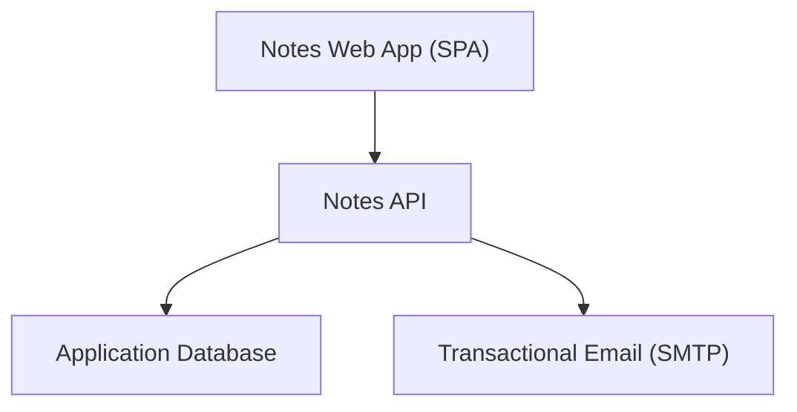
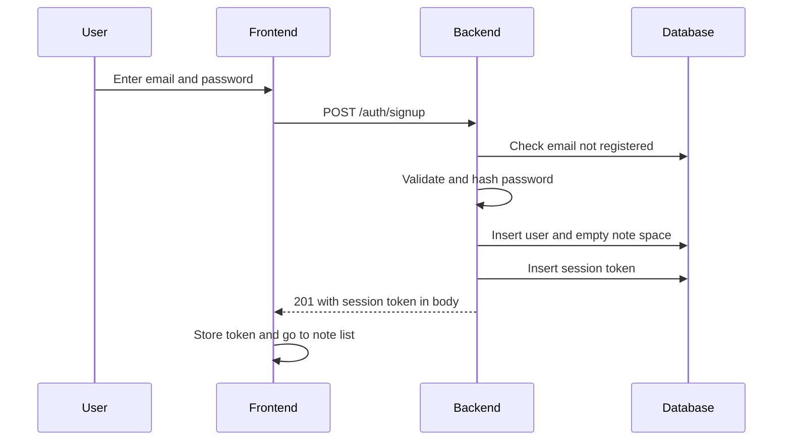
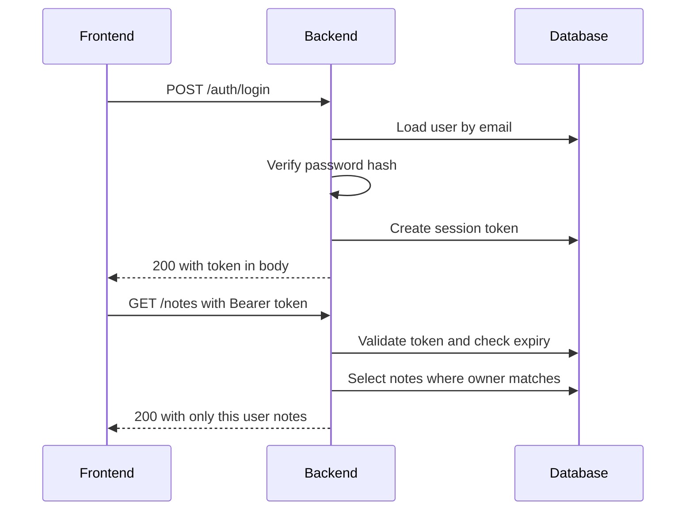
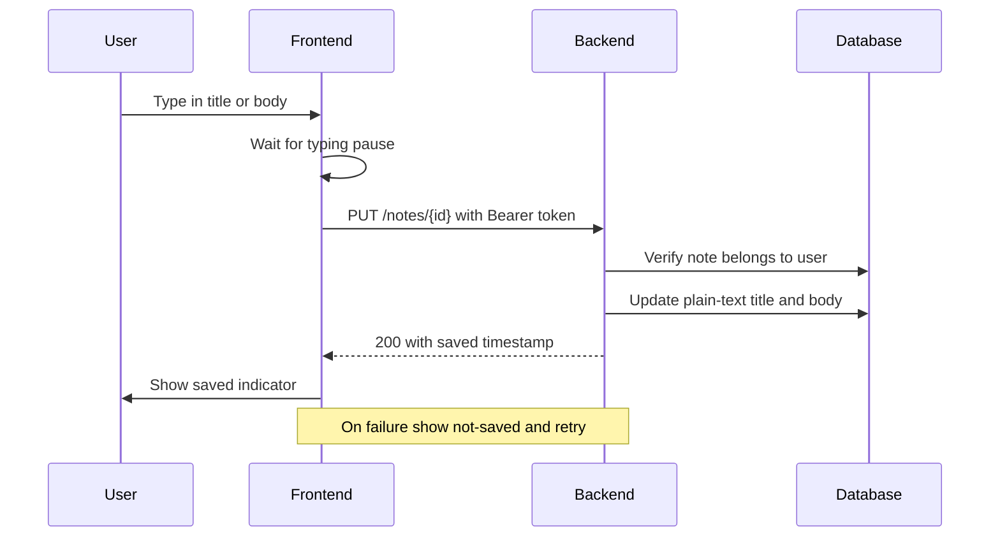
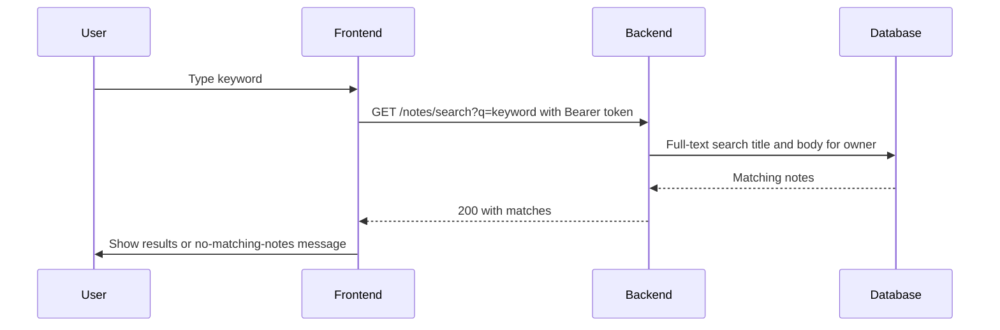
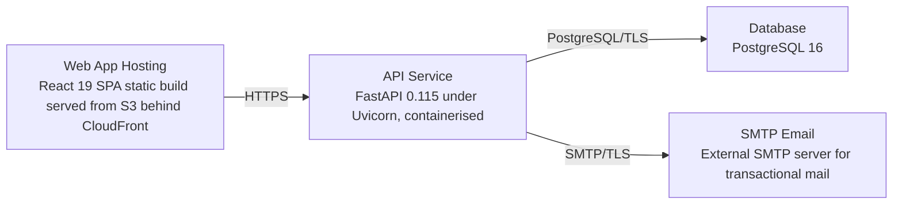

# Architecture

> Maintained by QuorQ AI SDLC. Text between `sdlc:auto` markers is regenerated; anything outside them is yours and is kept.

<!-- sdlc:auto:start narrative -->
## Overview

### ARCH-OVERVIEW · approved · source: architecture:summary

Simple Note Pad is a lightweight, free, responsive single-page app for private plain-text notes with auto-save, cross-device sync and keyword search, built on an approved React/FastAPI/PostgreSQL/AWS stack.

Users sign up with email and password, then create, read, edit, delete and keyword-search their own private plain-text notes. Changes auto-save and sync server-side across devices. Built exactly on the approved stack: React 19 SPA frontend, FastAPI 0.115 backend, PostgreSQL 16 database (also powers search via built-in full-text search, and stores accounts, notes and server-side sessions), all hosted on AWS. Sign-in uses opaque server-side session tokens sent as Authorization: Bearer headers because the SPA and API are served from separate origins. Transactional email (password reset) is sent through the approved SMTP service. Status: approved, version 1.

### ARCH-COMP-FRONTEND · approved · source: architecture:components:frontend

Notes Web App (SPA) built with React 19 handles sign-up/login/logout, the note list, the note editor with debounced auto-save, and live keyword search.

Responsive single-page UI for sign-up/login/logout, note list, note editor with debounced auto-save and saved indicator, and live keyword search. Stores the opaque session token and sends it as Authorization: Bearer on every API call. Reads API base URL from VITE_API_BASE_URL.

### ARCH-COMP-BACKEND · approved · source: architecture:components:backend

Notes API built with FastAPI 0.115 handles authentication, per-user note CRUD, search, account deletion and password-reset triggering.

Handles registration, login/logout and session validation, per-user note CRUD, full-text search over the user's own notes, account deletion, and triggering password-reset emails. Hashes passwords, issues and revokes opaque session tokens, and enforces per-user ownership on every note access.

### ARCH-COMP-DB · approved · source: architecture:components:database

PostgreSQL 16 is the durable store for accounts, notes, sessions and password-reset tokens, and also provides full-text search.

Durable store for accounts, notes (title plus plain-text body), server-side sessions and password-reset tokens. Provides built-in full-text search over note title and body scoped to the owner.

### ARCH-COMP-EMAIL · approved · source: architecture:components:email

An external SMTP service sends transactional email, specifically password-reset links and optional address verification.

Sends password-reset links (and optional address verification) over SMTP for the backend.

### ARCH-PATH-SIGNUP · approved · source: architecture:critical_paths:signup

Describes how a new visitor registers and is issued a session token.

New visitor submits email and password. Backend validates email format and password rules, rejects an already-registered email, hashes the password, creates the account and an empty note space, issues an opaque session token, and returns it in the response body for the SPA to store.

### ARCH-PATH-LOGIN · approved · source: architecture:critical_paths:login_and_token_auth

Describes login and how the Bearer token authorizes and scopes every subsequent note request.

Registered user logs in, receives an opaque token, then every note request carries Authorization: Bearer. Backend validates the token, checks expiry, and scopes all data to the owning user. Wrong credentials return a generic error without revealing which field was wrong.

### ARCH-PATH-AUTOSAVE · approved · source: architecture:critical_paths:auto_save

Describes the debounced auto-save flow for note edits, including offline/retry handling.

User edits title or body. After a short pause the SPA sends an update with the Bearer token. Backend confirms ownership and persists plain text, returning a saved timestamp. On network failure the SPA shows unsaved state and retries so no edit is silently lost.

### ARCH-PATH-SEARCH · approved · source: architecture:critical_paths:keyword_search

Describes how keyword search queries are scoped to the user and rendered, including the no-results case.

User types a keyword. The SPA queries the search endpoint with the Bearer token. Backend runs PostgreSQL full-text search over title and body scoped to the user and returns matches, or an empty set that the UI renders as 'no matching notes'.

### ARCH-DATA-MODEL · approved · source: architecture:entities

Four tables back the system: users, notes, sessions, and password_reset_tokens.

users: id, email, password_hash, created_at, email_verified. notes: id, user_id, title, body, search_vector, created_at, updated_at. sessions: token, user_id, created_at, expires_at. password_reset_tokens: token, user_id, created_at, expires_at, used_at.

### ARCH-API · approved · source: architecture:endpoints

The API exposes auth, note CRUD/search, and account-deletion endpoints, all enforcing per-user ownership via Bearer session tokens.

POST /auth/signup - create account with email/password, validate format and password rules, reject duplicate email, hash password, create empty note space, return opaque session token. POST /auth/login - authenticate and return opaque session token; generic error on mismatch without revealing which field was wrong. POST /auth/logout - revoke current session token. POST /auth/password-reset/request - send password-reset link by SMTP if email has an account; always returns success to avoid revealing which emails are registered. POST /auth/password-reset/confirm - set new password using a valid, unexpired reset token. GET /notes - list logged-in user's notes (id, title/label, updated_at), ordered by most recently updated. POST /notes - create a note with optional title and plain-text body in the user's own note space. GET /notes/{id} - return full title and body of one of the user's own notes; other users' notes are not returned. PUT /notes/{id} - auto-save update of title and/or body for one of the user's own notes, returns saved timestamp. DELETE /notes/{id} - delete one of the user's own notes after client-side confirmation, removing it on all devices. GET /notes/search - full-text search over the user's own notes by keyword against title and body; empty list when nothing matches. DELETE /account - delete the logged-in user's account and all their notes, and end all active sessions.

### ARCH-DEPLOY · approved · source: architecture:deployment_nodes

The system is deployed entirely on AWS: static SPA on S3/CloudFront, containerised API on App Runner/ECS Fargate, database on RDS, and email via an external SMTP SaaS.

Web App Hosting: React 19 SPA static build served from S3 behind CloudFront (static assets / CDN). API Service: FastAPI 0.115 under Uvicorn, containerised, Python 3.12, on AWS App Runner / ECS Fargate. Database: PostgreSQL 16 on Amazon RDS for PostgreSQL 16 (single instance). SMTP Email: external SMTP server for transactional mail (SaaS over SMTP).

### ARCH-TECH-FRONTEND · approved · source: architecture:technology_decisions:frontend

React 19 was chosen for the frontend over Vue and Svelte.

React 19 builds the responsive SPA (note list, editor with debounced auto-save, live search) and stores the opaque session token to send as a Bearer header. Built with Vite and reads VITE_API_BASE_URL at runtime. Alternatives considered: Vue, Svelte.

### ARCH-TECH-BACKEND · approved · source: architecture:technology_decisions:backend

FastAPI 0.115 was chosen for the backend over Flask and Django REST Framework.

FastAPI 0.115 serves the small set of auth and note endpoints with little code, validates request bodies with Pydantic, and enforces per-user ownership and session validation on every call. Alternatives considered: Flask, Django REST Framework.

### ARCH-TECH-DB · approved · source: architecture:technology_decisions:database

PostgreSQL 16 was chosen for storage and search over MySQL and SQLite.

PostgreSQL 16 stores accounts, notes, sessions and reset tokens durably, and its built-in full-text search (tsvector + GIN index) powers the keyword search without a separate search product. Alternatives considered: MySQL, SQLite.

### ARCH-TECH-CLOUD · approved · source: architecture:technology_decisions:cloud

AWS was chosen as the hosting cloud over Google Cloud and Azure.

AWS hosts the whole app in one place: the SPA on S3/CloudFront, the FastAPI API on App Runner/ECS Fargate, and PostgreSQL on RDS, with usage-based pricing that stays very low at modest scale. Alternatives considered: Google Cloud, Azure.
<!-- sdlc:auto:end narrative -->

<!-- sdlc:auto:start building-blocks -->
## Building Block View

| ID | Name | Technology | Responsibility | Depends on |
|---|---|---|---|---|
| frontend | Notes Web App (SPA) | React 19 | Responsive single-page UI for sign-up/login/logout, note list, note editor with debounced auto-save and saved indicator, and live keyword search. Stores the opaque session token and sends it as Authorization: Bearer on every API call. Reads API base URL from VITE_API_BASE_URL. | backend |
| backend | Notes API | FastAPI 0.115 | Handles registration, login/logout and session validation, per-user note CRUD, full-text search over the user's own notes, account deletion, and triggering password-reset emails. Hashes passwords, issues and revokes opaque session tokens, and enforces per-user ownership on every note access. | database, email |
| database | Application Database | PostgreSQL 16 | Durable store for accounts, notes (title plus plain-text body), server-side sessions and password-reset tokens. Provides built-in full-text search over note title and body scoped to the owner. | — |
| email | Transactional Email (SMTP) | SMTP server | Sends password-reset links (and optional address verification) over SMTP for the backend. | — |

<!-- sdlc:auto:end building-blocks -->

<!-- sdlc:auto:start runtime -->
## Runtime View

### Sign up and establish session

New visitor submits email and password. Backend validates email format and password rules, rejects an already-registered email, hashes the password, creates the account and an empty note space, issues an opaque session token, and returns it in the response body for the SPA to store.

- **Components:** frontend, backend, database
- **Modules:** auth_router, auth_service, password_hasher, session_store, user_repository
- **Key functions:** register(email, password), hash_password(password), create_session(user_id), is_email_taken(email)

### Login and token auth on note access

Registered user logs in, receives an opaque token, then every note request carries Authorization: Bearer. Backend validates the token, checks expiry, and scopes all data to the owning user. Wrong credentials return a generic error without revealing which field was wrong.

- **Components:** frontend, backend, database
- **Modules:** auth_router, auth_service, session_store, note_router, ownership_guard
- **Key functions:** login(email, password), verify_password(password, hash), validate_session(token), require_owner(user_id, note_id)

### Auto-save note edit

User edits title or body. After a short pause the SPA sends an update with the Bearer token. Backend confirms ownership and persists plain text, returning a saved timestamp. On network failure the SPA shows unsaved state and retries so no edit is silently lost.

- **Components:** frontend, backend, database
- **Modules:** note_editor, note_router, note_service, ownership_guard, note_repository
- **Key functions:** debounced_save(note_id, title, body), update_note(user_id, note_id, title, body), require_owner(user_id, note_id)

### Keyword search over own notes

User types a keyword. The SPA queries the search endpoint with the Bearer token. Backend runs PostgreSQL full-text search over title and body scoped to the user and returns matches, or an empty set that the UI renders as 'no matching notes'.

- **Components:** frontend, backend, database
- **Modules:** search_box, note_router, note_service, note_repository
- **Key functions:** search_notes(user_id, keyword), to_tsquery(keyword)

<!-- sdlc:auto:end runtime -->

<!-- sdlc:auto:start deployment-view -->
## Deployment View

| Name | Service | Runtime | Scaling | Environment |
|---|---|---|---|---|
| Web App Hosting | React 19 SPA static build served from S3 behind CloudFront | Static assets (CDN) | CDN edge caching | dev |
| API Service | FastAPI 0.115 under Uvicorn, containerised | Python 3.12 on AWS App Runner / ECS Fargate | 1 small instance for dev, horizontal if load grows | dev |
| Database | PostgreSQL 16 | Amazon RDS for PostgreSQL 16 (single instance) | Vertical; sized for thousands of users | dev |
| SMTP Email | External SMTP server for transactional mail | SaaS over SMTP | Provider-managed | dev |

| Source | Target | Protocol |
|---|---|---|
| Web App Hosting | API Service | HTTPS |
| API Service | Database | PostgreSQL/TLS |
| API Service | SMTP Email | SMTP/TLS |

<!-- sdlc:auto:end deployment-view -->

<!-- sdlc:auto:start decisions -->
## Architecture Decisions

| Layer | Choice | ADR |
|---|---|---|
| Frontend | React 19 | [ADR-0001](adr/frontend.md) |
| Backend | FastAPI 0.115 | [ADR-0002](adr/backend.md) |
| Database | PostgreSQL 16 | [ADR-0003](adr/database.md) |
| Cloud | AWS | [ADR-0004](adr/cloud.md) |
<!-- sdlc:auto:end decisions -->

<!-- sdlc:auto:start links -->
## Related Documents

- [Data Model](data-model.md)
- [API Specification](api/openapi.yaml)
- [Architecture Decision Records](adr/README.md)
<!-- sdlc:auto:end links -->
